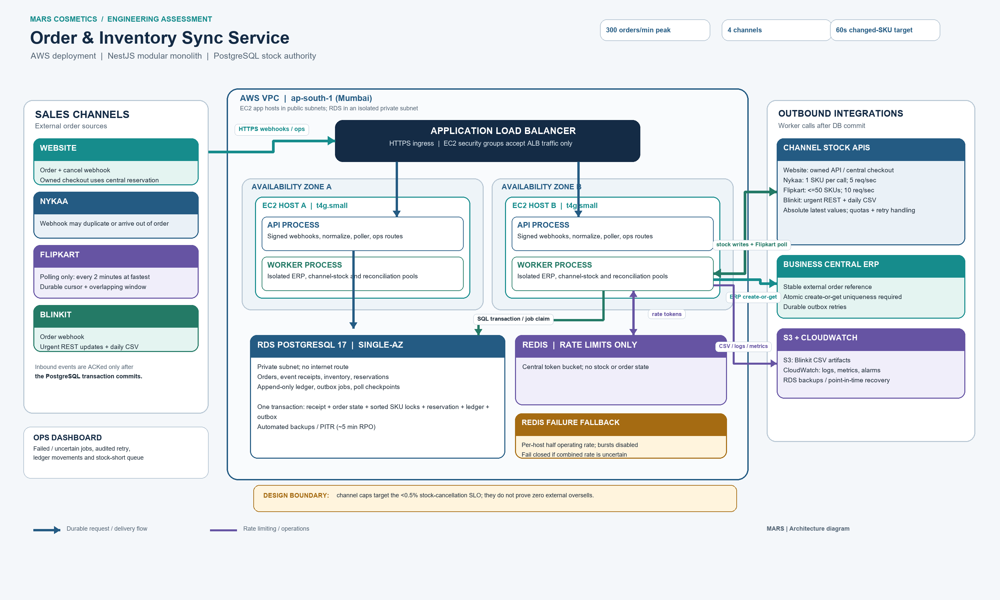

# Order & Inventory Sync Service: System Design

**Candidate:** Preet Karwal (Backend Engineering) | **MARS Cosmetics Engineering Assessment**  
**Constraints:** 6-week v1 delivery, 3 engineers, ₹50,000/month infrastructure budget.  

---


## 1. Architecture, Contracts & Data Flow

PostgreSQL is our single, non-negotiable authority for stock and orders. At our 300 orders/min (5 orders/sec) peak, message brokers (Kafka/RabbitMQ) or microservices introduce severe operational overhead, dual-write failure modes, and unneeded costs. A modular monolith in NestJS with a PostgreSQL transactional outbox delivers strict ACID guarantees and easily handles this workload for a 3-engineer team.



### Deployment Topology
* **Compute & Egress:** Two small EC2 instances (`t4g.small`) across two AZs behind an ALB. Direct Internet Gateway egress eliminates the expensive $32/mo AWS NAT Gateway, while Security Groups restrict inbound traffic exclusively to the ALB. RDS PostgreSQL resides in an isolated private database subnet.
  1. **API Process:** Ingests webhooks, runs the Flipkart poller, and serves ops endpoints.
  2. **Worker Process:** Handles outbound delivery (ERP sync and stock pushes), ensuring slow downstream marketplace APIs never starve webhook ingestion.
* **Database:** AWS RDS PostgreSQL 17 Single-AZ with automated continuous WAL archiving and daily snapshots (~5 min RPO). This deliberate trade-off fits within our ₹50k/month budget.
* **Rate Limiting:** Centralized Redis token-bucket rate gate (zero business state stored). **If Redis fails:** Each instance falls back to an in-process bucket capped at **50% of the planned operating rate** (Nykaa 2 req/s $\to$ 4 aggregate vs 5 limit; Flipkart 4 req/s $\to$ 8 aggregate vs 10 limit) with **bursts disabled** (capacity = 1). Outbound pushes fail closed if combined rates cannot be bounded.
* **Storage & Observability:** S3 stores generated Blinkit CSV snapshots; CloudWatch handles logs, metrics, and alarms.

### Assumptions & Guarantee Boundaries
1. **Channel Contracts:** Channels provide stable external order IDs, signed webhooks, and consistent SKU mappings. Flipkart polling supports pagination and filtering by `modified_after`.
2. **ERP Idempotency:** Microsoft Business Central (BC) must support atomic `create-or-get` on a unique external order reference (`channel:external_order_id`). This remote uniqueness constraint is the primary guarantee against duplicate invoices; local worker leases only prevent duplicate sends under normal conditions.
3. **No Direct Marketplace Cancel API:** Marketplaces do not expose a public endpoint for sellers to cancel orders on behalf of customers. When inventory is exhausted, our system marks the order `STOCK_SHORT` and routes it to an urgent ops queue for manual seller-portal cancellation.
4. **Data Standards:** Currency is stored as integer paise (minor units) to prevent floating-point inaccuracies. All timestamps are UTC internally.

### Common Order Format & Core Tables
Every incoming order payload is normalized into a canonical structure before entering the transaction:
`{ channel, external_order_id, event_id, event_type, source_version, occurred_at, items: [{ line_id, sku, qty, unit_price_minor }], payment_mode, shipping_pincode, total_minor }`. The raw JSON payload is preserved in `event_receipts` for replay.

| Table | Key Columns | Primary Constraints & Invariants |
| :--- | :--- | :--- |
| `orders` | id, channel, external_order_id, status, source_version | `UNIQUE(channel, external_order_id)`. Status: `RECEIVED`, `CONFIRMED`, `STOCK_SHORT`, `DISPATCHED`, `CANCELLED`, `RETURNED`, `TOMBSTONE`, `PENDING_RECONCILIATION`. |
| `order_lines` | order_id, line_id, sku, ordered_qty, cancelled_qty, shipped_qty, returned_qty | PK(`order_id, line_id`); `ordered_qty > 0`; `CHECK (cancelled_qty + shipped_qty <= ordered_qty AND returned_qty <= shipped_qty)`. |
| `event_receipts` | id, channel, event_id, request_hash, normalized_payload, state | `UNIQUE(channel, event_id)` where `event_id IS NOT NULL`. Replays match hash and ACK without side effects. |
| `inventory` | sku PK, on_hand, reserved, safety_buffer, version | **`CHECK (0 <= reserved AND reserved <= on_hand)`**. Hard-stops internal overselling at DB level. |
| `inventory_ledger`| id, sku, delta_on_hand, delta_reserved, reason, operation_key | **`UNIQUE(operation_key)`**; append-only audit log. Retries reuse operation keys, preventing duplicate stock movements. |
| `outbox_jobs` | id, kind, destination, operation_key, request_snapshot, state, next_at| `UNIQUE(kind, operation_key)`. State: `PENDING`, `CLAIMED`, `RETRY`, `FAILED`, `APPLIED`, `SUPERSEDED`, `PAUSED`. |

Child tables: `reservations(order_id, line_id, sku, held_qty)` tracks active line holds; `channel_stock(channel, sku, desired_qty, applied_version, dirty_since, uncertain)` tracks remote push states; `poll_checkpoints` tracks poller cursors. Duplicates are stopped by unique constraints across receipts, orders, and ledger keys.

<!-- page break -->

## 2. Ingestion & Inventory Correctness

### Webhooks, Polling & Out-of-Order Delivery
* **Webhooks (Website, Nykaa, Blinkit):** The adapter validates signatures and normalizes the payload. Processing runs within a single short PostgreSQL transaction: deduplicate receipt, upsert order, lock inventory rows, evaluate availability, append ledger entry, and insert outbox jobs. We **ACK HTTP 200 only after database commit**. If the database fails, we return `503`, prompting the channel to retry.
* **Flipkart Polling:** A poller runs every 2 minutes against Flipkart's API using a durable cursor and an overlapping **5-minute sliding window** (`watermark - 5 min`) to catch in-flight marketplace commits. The watermark advances only after all fetched pages are committed locally. Replays are completely safe due to our unique constraints.
* **Out-of-Order Events (The Nykaa Cancel-Before-Create Problem):** If an `ORDER_CANCELLED` event arrives before its `ORDER_CREATED` event, we insert an order row with status `TOMBSTONE`. When the delayed creation arrives, it detects the tombstone and halts, marking the order `PENDING_RECONCILIATION` rather than blindly allocating stock.
* **Source Versions vs. Timestamps:** Reliable source version numbers dictate forward-only transitions (`RECEIVED → CONFIRMED → DISPATCHED`). Stale versions are dropped. When versioning is absent, we do not rely blindly on wall-clock timestamps (which suffer from clock drift and skew); ambiguous events are quarantined for automated reconciliation.
* **Channel Failure Isolation:** Each outbound channel and the ERP has an isolated worker pool with independent circuit breakers. If Nykaa returns 500s or Flipkart rate-limits us, Website checkouts and Blinkit pushes continue unaffected.

### Two Channels Sell the Last Unit in the Same Second

Let SKU `MRS-LIP-104` have `on_hand = 1` and `reserved = 0` (`available = 1`). Transaction A (Website) and Transaction B (Nykaa) arrive at the exact same millisecond:
1. Both transactions begin in `READ COMMITTED` isolation, upsert their respective order headers, and execute `SELECT ... FOR UPDATE` on the affected SKU row, sorted alphabetically by SKU.
2. **Transaction A acquires the lock first.** It observes `available = 1 - 0 = 1`, increments `reserved = 1`, writes the hold and audit ledger, marks Order A `CONFIRMED`, inserts ERP and stock outbox jobs, and commits.
3. **Transaction B was blocked waiting for the row lock.** Once Transaction A commits and releases the lock, Transaction B acquires it and re-evaluates available stock: `available = 1 - 1 = 0`.
4. Transaction B detects insufficient stock. Because reservations are strictly all-or-none, it **reserves zero stock**, marks Order B `STOCK_SHORT`, immediately enqueues a zero-stock push for that SKU across all channels, and commits.

### Stock Reservation Logic
```text
BEGIN
  lock order row; if transition already applied: COMMIT, return
  SELECT sku, on_hand, reserved, safety_buffer FROM inventory WHERE sku IN (...) ORDER BY sku ASC FOR UPDATE
  aggregate requested quantities by distinct SKU across all order lines
  if any distinct SKU: (on_hand - reserved) < aggregated_demand:
    order.status = 'STOCK_SHORT'; insert zero-stock push; COMMIT
  else:
    reserve all lines; reserved += aggregated_demand; append unique ledger operations
    order.status = 'CONFIRMED'; insert ERP_ORDER + STOCK_PUBLISH outbox jobs; COMMIT
```

### What Happens to Customer B?
Order B is a paid marketplace order that cannot be fulfilled. It transitions to `STOCK_SHORT` and lands in a priority ops queue. The operations team cancels the order in Nykaa’s seller panel, initiating an automated marketplace refund and customer notification. This order counts toward our sale-day stock cancellation metric (<0.5% SLO).

### Stock Lifecycle & Exposure Risk Controls
* **Cancellations & Returns:** Pre-dispatch cancellation releases only the remaining hold once (`reserved -= qty`). Dispatch decrements `on_hand` and `reserved` together (`shipped_qty += qty`). Partial returns are tracked per line bounded by `returned_qty <= shipped_qty`. Returned units restock `on_hand` **only after physical warehouse inspection confirms sellability** (never on customer return request). Warehouse return operations are deduplicated by a unique `warehouse_operation_key` in `inventory_ledger`, preventing any repeated webhook or physical scan from restocking twice.
* **External Exposure as a Risk Control:** To minimize overselling while stock pushes are in flight, we enforce:
  $$\sum \text{Published Channel Caps} \le (\text{on\_hand} - \text{reserved} - \text{safety\_buffer})$$
  We divide available stock into conservative channel weights (e.g., Nykaa 20%, Flipkart 20%, Blinkit 20%), round remote shares down, and allocate the remainder to our owned website. However, channel caps are **risk controls, not absolute proof** against marketplace-side race conditions or delayed writes. Because marketplaces lack distributed 2PC reservations, strict external no-overselling requires channel cooperation; our exposure caps and buffers are **intended risk controls targeting the <0.5% cancellation SLO, which must be empirically validated against flash-sale traffic data**.

<!-- page break -->

## 3. Stock Push & Failure Recovery

### Channel Limits & Honest Capacity Math
* **Website:** Direct database access / owned API. Latency: <1 second.
* **Nykaa:** 5 requests/sec limit, strictly 1 SKU per request.
* **Flipkart:** 10 requests/sec limit, bulk API supporting up to 50 SKUs per request. Returns 429 when exceeded.
* **Blinkit:** Daily morning CSV upload + REST API for urgent changes (~2% timeout rate).

**The Mathematical Reality of Nykaa:** Updating all 1,200 SKUs on Nykaa at 5 calls/sec takes:
$$\frac{1,200 \text{ SKUs}}{5 \text{ calls/sec}} = 240 \text{ seconds (4 minutes minimum)}$$
At a safe operating pace of 4 calls/sec (leaving 20% headroom for retries), it takes **300 seconds (5 minutes)**. 

Therefore, promising an unconditional 60-second refresh for the entire catalog on Nykaa during a sale is mathematically impossible. Our design achieves the 60-second target by scoping it strictly to **changed ("dirty") SKUs under normal load**:
1. **Latest-Value Coalescing:** If SKU X changes 10 times in 10 seconds, outbox workers coalesce these into a single write carrying the latest desired quantity, preserving the oldest `dirty_since` timestamp.
2. **Priority Queuing:** Stockouts (`desired_qty = 0`) jump to the front of the queue immediately. Stock increases and slow-moving SKUs are deprioritized.
3. **Pacing Headroom & Multi-Host Fallback:** We pace Nykaa at a planned operating rate of 4 calls/sec (240 dirty SKU calls/min), leaving 20% headroom below Nykaa's 5/sec ceiling. If Redis fails, each host falls back to non-bursting local token buckets (capacity = 1) capped at 50% of planned operating rates (Nykaa 2 calls/s each, aggregate 4; Flipkart 4 calls/s each, aggregate 8 vs 10 ceiling) and fails closed if the combined rate cannot be bounded, avoiding 429 penalties. Flipkart batches up to 50 SKUs, updating the entire catalog in just 24 calls.

### Handling Blinkit Timeouts (2%) & CSV Coordination
* A network timeout is classified as `UNKNOWN`, not a failure.
* The system flags `channel_stock.uncertain = true` for that SKU.
* **Safe Fencing:** Stock decreases are retried immediately; **stock increases are withheld until remote state is reconciled**, preventing an old delayed write from overwriting a newer stock drop.
* **CSV Staging:** The daily CSV is generated from a clean off-peak snapshot and uploaded to S3. Urgent REST pushes supersede the CSV, and increases remain locked until the CSV import is confirmed.

### Durable ERP Delivery: Exactly-Once Business Effect
* Order confirmation and outbox job creation commit in the exact same database transaction.
* Workers claim due jobs using `SELECT ... FOR UPDATE SKIP LOCKED` with a lease timestamp. If a worker crashes mid-call, its lease expires and another worker reclaims it.
* Retries reuse the stable external order reference (`channel:external_order_id`). Business Central must enforce atomic uniqueness on this reference (`create-or-get`). A local sent flag or a non-atomic lookup-before-create cannot prevent duplicates if a network response drops after ERP acceptance.

### Sunday ERP Maintenance (1–2 Hours)
* **Zero Data Loss:** When Business Central goes offline, ingestion and stock reservations continue uninterrupted. The PostgreSQL Outbox safely absorbs the queue on disk:
  * Normal load (2 hours): ~667 orders (~1 MB storage).
  * Sustained peak (5 orders/sec for 2 hours): ~36,000 orders (~50 MB storage).
* **Catch-Up Drain:** Once ERP recovers, workers drain the backlog at an agreed 15 orders/sec. If new peak arrivals continue at 5 orders/sec, the net drain rate is 10 orders/sec, clearing 36,000 orders in 60 minutes (or 40 minutes under normal off-peak load).

### Circuit Breakers, Poison Messages & Ops Screen
* Transient network errors (5xx, 429, timeouts) retry with exponential backoff and jitter up to 10 attempts.
* Unrecoverable errors (invalid payload, auth failure, unknown SKU) skip retries and move straight to `FAILED` with an alert.
* Because outbox workers claim jobs row-by-row, a poison pill never blocks other healthy orders.
* **Operations Screen:** An authenticated dashboard allows ops to view failed/uncertain jobs. Retrying a job re-executes the original operation key; it cannot create a duplicate order or force an invalid stock transition.

<!-- page break -->

## 4. Operations, Cost Model & Delivery Plan

### Day-One Observability (5 Critical Alerts)
1. **Oldest Dirty Stock Age:** Elapsed time from inventory change to remote channel push. *Warn at 45s, Page at 60s under normal load.*
2. **Ingestion & Poller Health:** Webhook receive-to-reserve latency (alert if p99 > 1s) and minutes since last successful Flipkart poll (alert if > 4 minutes / 2 missed polls).
3. **ERP Backlog Age & Drain Rate:** Tracks oldest undelivered ERP job; alerts if backlog fails to drain post-maintenance.
4. **Sale-Day Stock-Short Rate:** Ratio of `STOCK_SHORT` orders to total accepted orders. *Warn at 0.3%, Page at 0.5% (SLO breach).*
5. **Database Invariant Sanity:** Automated 5-min check alerting immediately if `reserved > on_hand` or ledger balance drifts.

### Monthly AWS Infrastructure Budget (₹50k/month Target, ap-south-1 Mumbai)
* **Compute & Ingress (~₹5,000):** 2 x EC2 `t4g.small` instances behind 1 x ALB (direct Internet Gateway egress, ALB-only ingress security groups; avoids costly NAT Gateways).
* **Database (~₹18,000):** AWS RDS PostgreSQL 17 Single-AZ (`db.t4g.medium`, 2 vCPU, 4 GB RAM, 100 GB gp3 storage).
* **Storage & Monitoring (~₹5,000):** S3 CSV storage + CloudWatch Logs/Metrics + Redis rate-limiter on EC2.
* **Contingency & Taxes (~₹12,000):** Buffer for traffic spikes, data transfer, and 18% GST.
* **Total Estimated Spend:** **~₹40,000 / month**, fully compliant with the ₹50,000 ceiling.

### 6-Week Delivery Roadmap (3 Developers)
* **Weeks 1–2:** Database schema, migrations, transaction boundaries, inbox/outbox engine, mock adapters, and concurrency tests.
* **Weeks 3–4:** Real channel adapters (Nykaa, Flipkart, Blinkit), rate limiters, ERP idempotency contract, and Flipkart poller.
* **Week 5:** Ops screen endpoints, reconciliation jobs, failure injection drills, and peak load test (300 orders/min + hot SKU contention).
* **Week 6:** Database restore drill, runbooks, small-exposure production rollout, and sale day rehearsal.

### Architectural Trade-offs

| Decision | Chosen | Rejected | Engineering Rationale & Cost Impact |
| :--- | :--- | :--- | :--- |
| **Architecture** | **Modular Monolith** | Microservices | 3 developers cannot operate 5 microservices in 6 weeks. Monolith gives transactional consistency; worker pools isolate failures. |
| **Async Outbox** | **PostgreSQL Outbox** (`SKIP LOCKED`) | SQS / RabbitMQ | Eliminates dual-write inconsistencies (database commit vs. broker publish). Zero added infrastructure cost at 5 orders/sec. |
| **Concurrency Control** | **Row Locks in Sorted SKU Order** | Redis Distributed Locks | Redis locks risk split-brain and clock drift. PostgreSQL `SELECT FOR UPDATE` guarantees zero internal overselling across all transactional writers (external marketplace races remain a separate risk). |
| **High Availability** | **Single-AZ RDS + Automated PITR** | Multi-AZ RDS | Multi-AZ doubles RDS cost and adds synchronous commit latency. Within a ₹50k budget, Single-AZ with 5-minute RPO backups is the honest v1 trade-off. |
| **Marketplace Exposure**| **Conservative Caps ($\sum \le \text{Sellable}$)**| Full Stock Everywhere | Showing full stock everywhere guarantees catastrophic overselling during flash sales. Caps act as intended risk controls targeting the <0.5% cancellation SLO (to be empirically validated against sale data), accepting slight stock fragmentation. |

### Deliberate v1 Exclusions
1. **Multi-Warehouse Routing:** All inventory ships from one central warehouse. Multi-node routing adds split-order and tax complexity not required for v1.
2. **ML Demand Forecasting:** Static buffers and fixed channel splits are predictable and debuggable. Dynamic ML allocation is deferred to v2.
3. **Kafka or Kubernetes:** Managing distributed message clusters adds unnecessary operational burden for a 5 orders/sec workload.
4. **Automated Marketplace Cancellation API:** Marketplaces do not support it; handled via ops alerts and seller portals.

### AI Usage Note
Architected and authored by Preet Karwal; Google Gemini and OpenAI Codex were utilized for architectural peer review, edge-case stress testing, diagram rendering, and editorial formatting.

**References:** [PostgreSQL Explicit Locking](https://www.postgresql.org/docs/17/explicit-locking.html); [PostgreSQL SKIP LOCKED Job Queues](https://www.postgresql.org/docs/current/sql-select.html); [AWS RDS Backup & Restore](https://docs.aws.amazon.com/AmazonRDS/latest/gettingstartedguide/managing-backup-restore.html).
